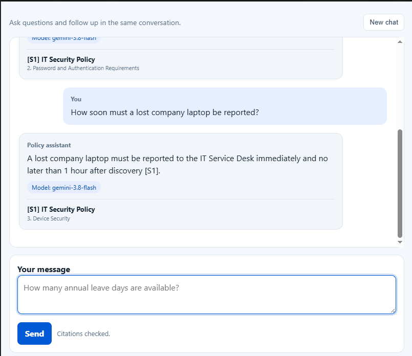
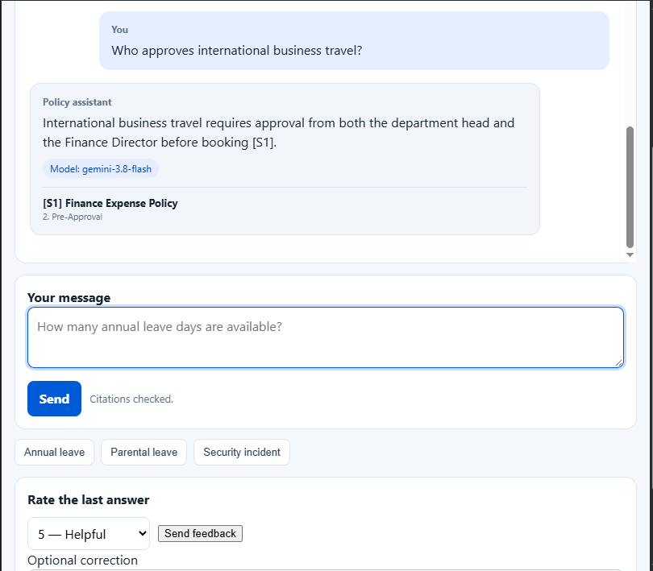
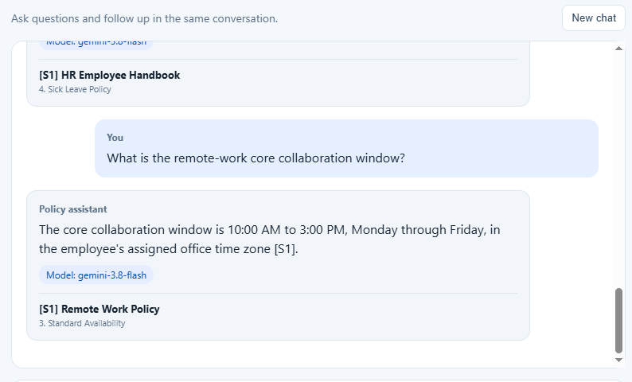
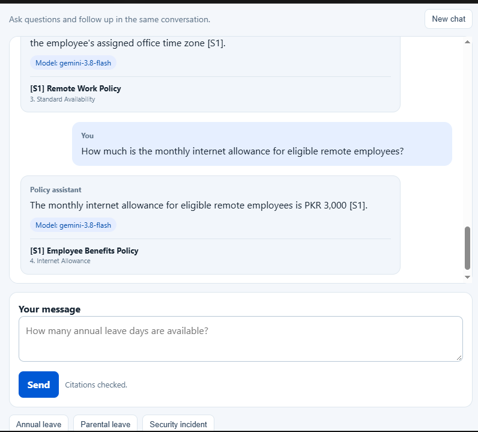
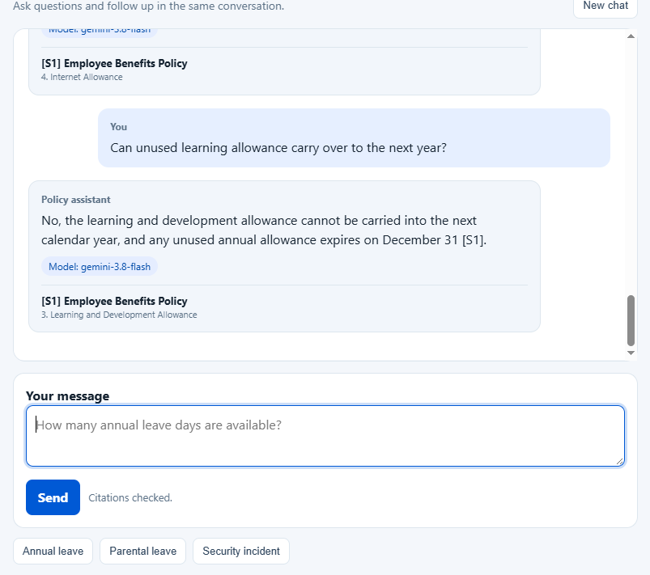

# Enterprise Knowledge Intelligence Platform

A local RAG (Retrieval-Augmented Generation) prototype that answers questions about company policy documents with inline citations. Add PDF, DOCX, or Markdown files, build the index, then ask questions from the command line or the local chat page.

It is intended as a learning and evaluation prototype. It does not include production authentication or multi-user access controls.

## Architecture and data flow

### Offline indexing

1. `app/ingestion/loader.py` finds supported PDF, DOCX, and Markdown files.
2. `app/ingestion/parser.py` extracts text and structure. DOCX headings and Markdown headings become section paths; DOCX tables become labeled rows. PDF pages retain page numbers, and likely headings are inferred from font size and bold styling. PDF heading detection is heuristic and can miss or misclassify headings.
3. `app/ingestion/chunker.py` groups parsed blocks into parent sections, then splits them into overlapping child passages. Children are the retrieval units; parent sections supply surrounding context.
4. `app/embeddings/contextualize.py` adds document title, ID, department, version, date, and heading path to each embedding input. The original child text remains unchanged for citations.
5. `app/embeddings/gemini.py` embeds child passages with the configured Gemini embedding model.
6. `app/retrieval.py` normalizes vectors and saves them in a local FAISS index. Chunk metadata is stored in `chunks.json`, and build information is stored in `manifest.json`.

### Query and answer

1. The original question and a compact keyword version are embedded together. The compact version is built locally, without another Gemini request.
2. FAISS searches both vectors, while BM25 searches the original child text for exact words, numbers, and identifiers. Reciprocal Rank Fusion combines all ranked lists using `1 / (60 + rank)`, so dense search contributes semantic matches and BM25 contributes lexical matches without comparing their raw scores.
3. An optional local `cross-encoder/ms-marco-MiniLM-L-6-v2` reranker can reorder candidates. It is disabled by default: the latest 15-question comparison still shows slightly lower MRR and nDCG after MiniLM reranking. See [the submission validation report](docs/submission-validation.md) for the measured results.
4. Selected child passages are expanded to their parent sections for generation.
5. Gemini generates an answer from retrieved evidence and adds citation labels. Citation validation checks that labels refer to supplied sources and that answer sentences include citations. It does not establish that a cited source semantically supports every claim.

The standard retrieval path is hybrid: dense search handles semantic matches, BM25 helps with exact terms and numbers, and RRF fuses their ranked lists. BM25 is rebuilt from saved child text when the local index loads, so it requires no extra Gemini calls and no separate persisted artifact.

## Example

**Question:** How many annual leave days are available?

**Answer:** Full-time employees receive 20 annual leave days per calendar year [S1]. Up to 5 unused days may be carried forward into the next calendar year [S1]. Part-time and contract employees' entitlements are determined by their individual employment agreements [S1].

**Source:** [S1] HR Employee Handbook — Section: 3. Annual Leave Policy.

## Gemini model fallback

Generation tries the configured primary model, followed by the ordered fallback models in `.env`. A quota response skips that model and puts it on a cooldown saved under `artifacts/retrieval/`. A temporary server error is retried once before moving to the next model. Network timeouts also move to the next model. Authentication and malformed-request errors stop immediately because switching models will not resolve them.

Fallback applies to generation only. Embeddings use one configured model because vectors from different embedding models cannot be mixed in one FAISS index. Changing the embedding model requires rebuilding the index.

## Setup (PowerShell)

Run these commands from the project root:

```powershell
py -3.11 -m venv .venv
.\.venv\Scripts\Activate.ps1
python -m pip install -r requirements.txt
Copy-Item .env.example .env
notepad .env
```

Add your Gemini key after `GEMINI_API_KEY=` and save. The `.env` file is ignored by Git. Put the policy files you want to query in `data/raw/`; source documents and generated indexes are not included in this public repository. Then build the index:

```powershell
python -m app.retrieval build
```

Build a fresh index after changing source files or the configured embedding model. The build reads the complete `data/raw/` corpus and replaces the saved index artifacts; single-document incremental updates are not supported.

## Commands

Search and show ranked evidence:

```powershell
python -m app.retrieval search "How many annual leave days are available?"
```

Compare the dense baseline, dense multi-query/RRF, hybrid dense + BM25 + RRF, and hybrid reranking against the labeled question set:

```powershell
python -m app.retrieval evaluate
```

The set is `data/evaluation/retrieval_questions.json`. Each entry contains a `query` and one or more manually labeled `relevant_child_ids`. Add questions with relevant IDs from the current index. The set currently has 15 questions and is intended for development comparisons, not as a general accuracy guarantee.

Generate a grounded answer:

```powershell
python -m app.generation "How many annual leave days are available?"
```

Start the local chat API:

```powershell
python -m uvicorn app.api:app --host 127.0.0.1 --port 8000
```

Open `http://127.0.0.1:8000/`. The chat page keeps up to eight recent turns in browser memory while the tab stays open; short follow-up questions use the preceding user question to retrieve the relevant section. Use **New chat** to clear the conversation. The API also provides `GET /health`, `GET /v1/index`, `POST /v1/query`, `POST /v1/feedback`, and interactive docs at `/docs`.

## Configuration

- `GEMINI_API_KEY`: local secret; never commit it.
- `GEMINI_EMBEDDING_MODEL` and `GEMINI_EMBEDDING_DIMENSIONS`: embedding-space configuration. Changing either requires rebuilding all vectors.
- `GEMINI_GENERATION_PRIMARY_MODEL` and `GEMINI_GENERATION_FALLBACK_MODELS`: ordered generation fallback chain.
- `GEMINI_REQUEST_TIMEOUT_MS`: timeout for each Gemini request.
- `GEMINI_MODEL_COOLDOWN_SECONDS`: generation model cooldown after quota errors.
- `EVIDENCE_TOKEN_BUDGET`: approximate maximum source-evidence token budget. Chunk and evidence counts use GPT `cl100k_base` as an approximation, so they may differ from Gemini's tokenizer.
- `RRF_K`: RRF rank constant; default is 60.
- `RERANKER_MODEL`, `RERANKER_CANDIDATES`, `ENABLE_RERANKER`: optional local reranking settings.

## Project structure

```text
app/
  ingestion/
    loader.py          Discover and dispatch supported files
    parser.py          Extract PDF, DOCX, and Markdown text and section paths
    chunker.py         Create parent sections and child passages
    schemas.py         Parsed document, parent, child, and metadata records
  embeddings/
    contextualize.py   Add document metadata to embedding input
    gemini.py          Gemini embedding client
  retrieval.py         FAISS + BM25 indexes, query variants, RRF, reranking, evaluation
  generation.py        Grounded answers, generation fallback, citation checks
  api.py               Local FastAPI endpoints
  static/index.html    Browser chat interface
data/
  evaluation/          Labeled retrieval questions and answer review records
  raw/                 Place source documents here locally; files are Git-ignored
artifacts/retrieval/   Generated FAISS index and metadata; Git-ignored
```

## Known limitations

- **PDF headings are heuristic.** Typography-based heading detection can miss headings or classify short bold text as a heading. Check section paths when using PDFs with unusual layouts.
- **Tokenizer approximation.** Chunk and evidence budgets use GPT `cl100k_base`, not Gemini's tokenizer, so counts are approximate.
- **Small evaluation set.** The 15 labeled queries help compare retrieval changes on this corpus. Results do not generalize to unseen documents or question types.
- **Citation checks are structural.** Valid citation labels do not prove semantic claim support. Review generated answers against their cited passages.
- **No authentication.** Keep the API bound to localhost; do not expose it to a network without adding access controls.
- **Single-browser chat history.** Conversation history is held in browser memory and is lost when the tab is closed. It is not shared across users or devices.
- **Reranker results are corpus-dependent.** MiniLM is optional and its score is not a probability. An earlier dense-only comparison showed a small ranking regression. Reranking stays disabled by default until its effect on hybrid results is measured.

## Latest validation

The current local run passed all 8 tests (including 10 document subtests). On the 15-question evaluation set, dense retrieval and dense + BM25 + RRF both scored 1.000 for Hit Rate@5, MRR@5, Recall@10, and nDCG@10. This set does not show a metric gain from BM25; BM25 remains useful to test exact identifiers and terms beyond this small set. MiniLM reranking lowered MRR@5 to 0.967 and nDCG@10 to 0.975, so it remains disabled by default. See [the full submission validation report](docs/submission-validation.md) for the sample answer and API check.

## Screenshots

The screenshots below show answers with their policy citations in the local chat interface.










